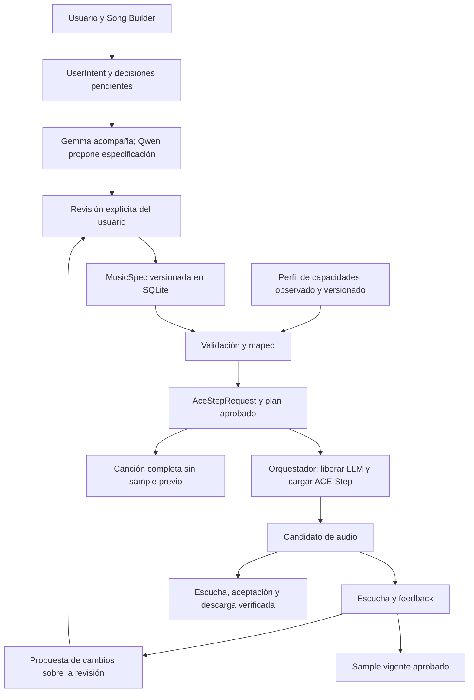

# Song Builder orientado a ACE-Step: análisis y migración

## Decisiones vigentes del usuario — 2026-10-07

[Contrato de decisiones](SONG_BUILDER_APPROVED_DECISIONS_20261007.md): **sample previo opcional, sin bloqueo de generación completa**; instrumental como intención soportada con ejecución condicionada a validación; dirección por sección en MusicSpec aunque su traducción tenga límites; referencia audio opcional/avanzada, sin clonación; perfil ACE-Step automático por defecto y manual disponible para cualquiera. Esta decisión sustituye requisitos anteriores incompatibles en este documento. Las descripciones de pruebas/gates del árbol anterior son históricas; retirar el bloqueo de sample sigue pendiente de implementación y regresión. Mantener set válido, request confirmado y evaluación/aceptación de audio separadas.

Fecha: 2026-10-07. Alcance: análisis previo al rediseño solicitado. No implementa las pantallas propuestas ni cierra sprints. Se contrastaron código, SQLite de prueba, interfaz con Playwright MCP y fuente instalada del motor. Se mantiene la configuración Vulkan vigente de Gemma/Qwen.

## A. Estado actual y evidencia

La aplicación ya dispone de assets separados, sets, revisiones de `song_specs`, catálogo, propuestas Qwen, asistencia Gemma, compilador de plan, controles de ACE-Step, jobs, orquestación, candidatos, revisión de escucha, sample y exportación. Se preservan estos componentes.

La ruta moderna de candidatos y canción completa con ACE-Step no requiere MIDI. La ruta histórica segmentada de instrumental sí consulta el servicio MIDI. La navegación y algunas instrucciones mezclan ambas rutas: no representan un único recorrido coherente.

Auditoría aislada en `data/qa_ui_inputs_20261007`, copia de la DB y archivos del proyecto QA; servidor temporal 8013, sin modelos ni generación de audio:

| Comprobación | Resultado y límite |
| --- | --- |
| Catálogo de ficha | 49 campos, 6 familias, **0 editores dentro del catálogo**. Mostrar cobertura no acredita editabilidad. |
| Formulario del motor | 16 campos del catálogo tienen editor dedicado de motor/calidad; dos rutas de audio son derivadas y el perfil de voz está pendiente. Los otros 30 campos creativos/de entrega no tienen editor directo de la misma revisión; algunos tienen formularios de fase separados. |
| Seis acciones | Cambiar text2music, cover, repaint, lego, extract y complete modifica controles relevantes. No se ejecutaron los seis modos. |
| Persistencia probada | Seed 24680, pasos 8, guidance 1 y shift 3 guardados y recuperados tras recarga. |
| Edición y descarte | Base, API de alto nivel, fuerza 0.75, pista guitar, instrucción, intervalo 1.5–4.5, tolerancia 2 y LM 0.6B manipulados; descarte comprobado. No demuestra inferencia con esos valores. |
| Audio fuente/referencia | Selectores presentes pero sin archivos seleccionables en esta copia; no existe importación de audio propio en esta superficie. El fixture no demuestra ausencia de artefactos en otros proyectos. |
| Desalineación reproducida | Guardar BPM 97 en Music Plan devuelve HTTP 200 y conserva 97 tras recarga; la ficha para ACE-Step conserva 72 y la misma revisión. No hay sincronización de esa decisión. |
| Inventario estático | 98 enlaces `v-model` únicos; no equivalen a 98 controles probados. Fuente instalada: 72 campos GenerationParams y 9 GenerationConfig; no equivalen a 81 controles ejecutables de Song AI. |
| Build | Vite compiló. La auditoría no valida audio, GPU, fidelidad real ni usabilidad amateur. |

Inventario reproducible: `.playwright-mcp/ui-input-audit/inventory.py` y `inventory.json`. ACE instalado: distribución 1.5.0, commit `dce621408bee8c31b4fcf4811682eb9359e1bc94`; SHA256 de `acestep/inference.py`: `234cd6f32b7dfd62a5792918b5bc5a0e0e8cc4b190bdf9f5fcef9ea57485b0c5`. Una firma o un peso disponible no acredita ejecución ni calidad.

## B. Problemas que resolver

1. Formularios de fases y ficha representan valores distintos. El usuario necesita ver propuesta, borrador y revisión guardada, y guardar una revisión explícita compartida por chat y controles.
2. El catálogo informa, pero no permite configurar toda la intención. La interfaz debe ofrecer editor, delegación o explicación de indisponibilidad para cada campo.
3. MIDI aparece como fase principal pese a no alimentar la ruta ACE-Step vigente. Debe salir del recorrido principal y conservarse como función histórica opcional.
4. Reglas de acciones, rangos, opciones y disponibilidad están repartidas entre UI, validadores, perfiles y compilador. Deben compartir un perfil de capacidades versionado.
5. El booleano nativo `instrumental` no está conectado. La opción visible «instrumental» no garantiza una generación sin canto. Añadir el argumento no basta: comprobar si la ruta instalada consume ese campo y contrastar la adaptación de letra/caption y el audio obtenido. Conservar las tres piezas y representar la letra instrumental conforme al contrato, sin eliminarla del set.
6. No hay entrada completa de audio propio para los modos que necesitan fuente. Seleccionar un artefacto existente no sustituye importar, verificar y registrar un archivo.
7. Humanización, respiraciones, vibrato y mezcla aparecen en fases históricas; no deben anunciarse como operaciones deterministas de ACE-Step cuando solo son deseos expresables mediante texto o no están conectadas.
8. El resumen de creación omite decisiones de otros formularios e incluye salidas fijas. El pedido debe derivarse de la revisión aprobada, nunca de un resumen parcial independiente.

## C. Arquitectura objetivo, incremental y hexagonal



Los modelos no se llaman entre sí: tasks, estados y repositorios coordinan cada handoff. UserIntent conserva deseos y mensajes de origen; no es una segunda configuración ejecutable. MusicSpec evoluciona `song_specs.json_spec` y sus revisiones existentes. AceStepRequest es una proyección compilada, congelada y trazable; no otra fuente editable.

Responsabilidades propuestas:

| Componente | Responsabilidad y reutilización |
| --- | --- |
| MusicSpecApplicationService | Un caso de uso de patch/revisión para formulario y chat. Generalizar validación optimista y transacción existentes en `ace_step_configuration.py`. No guardar sugerencias automáticamente. |
| BuilderDecisionPlanner | Calcular siguiente pregunta, decisiones conocidas, relevancia, conflictos y pendientes desde la revisión y capacidades; no preguntar de nuevo datos confirmados. |
| AceStepCapabilityProfile | Objeto de dominio versionado, restricciones y estado observado. Puerto para disponibilidad local; adaptador inspecciona instalación/preflight. |
| AceStepCapabilityMapper | Informe por requisito: traducción, límites, evidencia y conflictos. Extraer responsabilidades del compilador actual, sin duplicar lógica. |
| AceStepRequestCompiler | Evolucionar `ace_step_plan_compiler.py`: producir argumentos exactos, archivos caption/lyrics, hashes y valores efectivos desde revisión aprobada. |
| Repositorios y orquestador actuales | SQLite, assets, tasks, historial, exclusión de memoria, recuperación y ejecución. Mantener providers intercambiables. |

SOLID: UI no conoce argumentos del handler; perfil no arranca modelos; compilador no administra memoria; orquestador no decide deseos. DRY: una regla de capacidad alimenta formulario, validación y compilación. Las decisiones explícitas del usuario prevalecen sobre especificación confirmada anterior, inferencias, sugerencias y defaults; un cambio sigue necesitando guardado explícito y nueva confirmación cuando corresponda.

## D. MusicSpec y procedencia

Migrar por versiones, sin mantener dos documentos activos. Inicialmente proyectar el esquema plano 1.1 existente a la UI; solo introducir esquema 2.0 con migración atómica, lectura compatible y pruebas de exportación. JSON/Markdown se regeneran desde la misma revisión SQLite.

| Familia propuesta | Contenido y utilidad |
| --- | --- |
| Identidad y concepto | Título, destinatario, ocasión, descripción, idioma, emoción y tema. Explican intención y contexto, no todos son parámetros nativos. |
| Instrumental | Género/estilo, instrumentos, groove, BPM, tonalidad, compás y arco dinámico. Metadatos directos o condicionamiento caption. |
| Voz y melodía vocal | Presencia de canto, estilo, rango, expresión, pronunciación y capas deseadas; referencia/perfil opcional con capacidad declarada. No exige MIDI. |
| Letra | Asset/version, idioma, secciones y texto; narrador, tono, frases obligatorias, exclusiones y rima. Validar texto antes de compilar; no asumir que conservar una restricción en JSON hace obedecer al audio. |
| Estructura | Secciones, orden, duración estimada, intensidad y transiciones. Tags/caption orientan; no prometen duración exacta por sección. |
| Operación y referencias | Acción, fuente, referencia opcional, pistas e intervalo cuando aplican; IDs verificados y checksums, nunca rutas arbitrarias del usuario. |
| Producción y entrega | Duración, sample representativo, equilibrio deseado, perfil técnico, formatos derivados y evaluaciones de aceptación. |
| Requisitos y decisiones | Obligatorio/preferido, alcance, procedencia, confirmación, delegación, evidencia y trazabilidad hasta parámetros/audio. |

Valores canónicos únicos por campo. Metadatos de decisiones referencian su JSON Pointer, evitando copiar el valor en varias estructuras. Ejemplo de evolución conceptual:

```json
{
  "schema_version": "2.0",
  "instrumental": {"bpm": 97},
  "decisions": {
    "/instrumental/bpm": {
      "origin": "USER", "confirmation": "confirmed",
      "source_event_id": "event_id", "priority": "preferred"
    }
  },
  "requirements": [
    {"id": "r1", "statement": "Conservar una frase literal",
     "priority": "mandatory", "scope": "lyrics", "source_event_id": "event_id"}
  ]
}
```

La revisión, proyecto, actor y fechas usan el modelo SQLite existente. Orígenes: USER, AI_INFERRED, AI_SUGGESTED, DEFAULT y SYSTEM. Conservar alias históricos en migración. Confianza opcional: una estimación del modelo debe etiquetarse como estimación, nunca como aceptación ni evidencia de audio. Delegar explícitamente permite proponer valores; no equivale a aprobarlos por silencio.

Separar completitud por etapa, validación determinista, revisión Qwen, confirmación creativa, aprobación de plan y aprobación del audio. Guardar los hashes de revisión, capacidades, steering, assets y configuración efectiva que sustentan cada ejecución.

## E. Perfil de capacidades y traducción

El perfil reúne contrato de `docs/ACE_STEP_CAPABILITIES.md`, fuente instalada y observación local; mantener separados documentado, conectado, ejecutado y calidad aceptada. No convertir automáticamente cada campo de la API instalada en un control.

| Acción | Inputs particulares | Modelo local y limitación |
| --- | --- | --- |
| text2music | Caption y letra/metadatos según intención; no necesita MIDI ni audio guía | Base/Turbo según perfil; LM interno opcional solo en esta ruta. |
| cover | Audio fuente y fuerza; referencia musical opcional según adaptación | Verificar fuente/duración y perfil. Referencia no acredita identidad vocal. |
| repaint | Audio fuente e intervalo válido | Validar límites contra duración de fuente. |
| lego | Fuente, una pista, instrucción e intervalo aplicable | Base; Turbo incompatible con contrato actual. |
| extract | Fuente, una pista e instrucción | Base; no exigir intervalo de repaint. |
| complete | Fuente, una o más pistas e instrucción | Base; no exigir intervalo de repaint. |

Pistas actuales: vocals, backing_vocals, drums, bass, guitar, keyboard, percussion, strings, synth, fx, brass, woodwinds. El perfil declara cardinalidad por modo y deriva instrucciones compatibles. Disponibilidad de Base y de cada operación debe acreditarse con preflight y ejecución; no habilitar por el nombre del directorio.

Perfil mínimo: `profile_version`, `provider`, `installed_revision`, `observed_at`, `source_hashes`, `modes`, `models`, `fields`, `required_inputs`, `optional_inputs`, `constraints`, `incompatible_inputs`, `defaults`, `effective_fixed_values`, `execution_evidence`. La UI consume una proyección pública del mismo perfil que valida backend.

Rangos actualmente conectados: BPM 30–300; pasos Turbo 1–20/Base 1–200; guidance 1–15 pero Turbo exige 1; shift 0.1–10; seed 0–4294967295; duración del compilador 10–600 s. El formulario de idea restringe BPM 48–240: reconciliarlo con el perfil o explicar un rango recomendado distinto del permitido. No exponer defaults nativos de autodetección si el adaptador no los soporta.

Clasificación del mapeo, por requisito:

| Ruta | Ejemplos y comportamiento |
| --- | --- |
| Directa | BPM, tonalidad, compás, idioma vocal, duración, seed/pasos, acción y argumentos admitidos. Probar traducción por ruta handler/alto nivel. |
| Caption/tags/lyrics | Estilo, emoción, instrumentos, rango, dinámica; frases y estructura requieren preparación/validación de letra. Condicionamiento aproximado, no garantía. |
| Requiere referencia | Operaciones sobre audio existente. Solicitar fuente solo cuando corresponde, comprobar propiedad/integridad. |
| No soportada/no conectada | Clonación de identidad, MIDI como órdenes de notas, DSP por texto y booleano instrumental actual. Explicar y mantener deseo sin fabricar soporte. |
| Conflictiva | Lego/Turbo, intervalos fuera de fuente, letra contra exclusiones, formato o rango incompatible. Resolver antes de ejecutar. |

«Inferida» es procedencia, no una ruta excluyente: un BPM inferido también se traduce directamente. El informe registra ambas dimensiones. Un requisito obligatorio sin traducción aceptable bloquea ejecución y pide decisión explícita; uno preferido puede documentar aproximación aceptada.

Inventario de API: parámetros como global_caption, normalización/fades, DCW, sampler, retake y flow-edit existen en la fuente instalada pero no deben presentarse como conectados sin pruebas del wrapper. No inventar un séptimo modo. GenerationConfig contiene políticas de lote/semillas/formato; el wrapper de alto nivel fija lote 1 y WAV. Registrar valores efectivos y distinguir controles delegados de funciones ausentes.

## F. Recorrido y pantallas del Builder

Una interfaz común asistida para todas las personas, sin niveles de experiencia. Controles musicales visibles con etiquetas claras y tooltips que explican significado, efecto y ejemplo; ayuda disponible por teclado y toque. Los ajustes adicionales se agrupan por tarea/relevancia y están accesibles para cualquiera. La IA recomienda y explica sin reemplazar decisiones USER; la misma MusicSpec alimenta controles y chat.

| Paso | Qué ingresa/revisa el usuario | Qué produce y condición para avanzar |
| --- | --- | --- |
| 1. Idea | Describe ocasión/emoción, idioma y deseos o límites conocidos. Datos desconocidos se pueden delegar expresamente. | UserIntent persistido. Gemma explica preparación y tres piezas pendientes; no crea set incompleto. |
| 2. Instrumental | Estilo, instrumentos, energía; BPM/tonalidad/compás avanzados, propuestas explicadas. | Draft e intención instrumental revisables, sin exigir composición ni MIDI. |
| 3. Voz y melodía | Canto deseado, expresión, rango/energía; voz generada, referencia o grabación humana claramente diferenciadas. | Draft de melodía vocal e intención; perfil personalizado opcional pendiente, sin bloquear voz generada. |
| 4. Letra | Escribe, pide propuesta o edita secciones; frases literales, exclusiones, nombres, narrador y tono. | Draft de letra revisado; comprobar restricciones y placeholders. |
| 5. Elegir proyecto | Selecciona instrumental, melodía vocal y letra, ve qué falta. | Set válido; contar drafts disponibles no sustituye selección válida. |
| 6. Ficha compartida | Revisa propuesta Qwen por familias, cambia campos o delega, ve origen y diff. | Nueva MusicSpec guardada y confirmada. Chat y controles comparten revisión. |
| 7. Acción del motor | Crear desde texto por defecto; otras acciones muestran fuente, pistas, fuerza o intervalo pertinentes. Importa audio cuando se requiere. | Perfil/capacidades y requisitos validados; caption/lyrics finales visibles y plan aprobado. |
| 8. Generar prueba | Acción principal única; progreso, espera, cancelación/recuperación explicados. | Plan persistido; orquestador descarga LLM antes de cargar ACE-Step; candidato identificado, no calidad aprobada. |
| 9. Escuchar y ajustar | Escucha, evalúa fidelidad, propone «más alegre», «menos guitarra» o cambios concretos. | Feedback convertido en diff versionado; usuario guarda; revalidar y regenerar/editar con modo compatible. |
| 10. Aprobar sample | Escucha artefacto representativo del set, revisión, voz/provider/configuración relevantes. | Aprobación vinculada a hashes vigentes; cambios creativos la invalidan. Mock/guía no acredita producción real. |
| 11. Canción y descarga | Genera final, escucha completo y acepta resultado; elige formatos disponibles. | Backend exige set válido y request confirmado, sin sample opcional; integridad técnica, escucha y aceptación separadas; descarga solo artefactos verificados. |

Estados visibles: preparación, propuesta pendiente, borrador sin guardar, revisión guardada, conflicto, listo para confirmar, plan aprobado, liberando modelos, generando, candidato disponible, sample por revisar, sample vigente, final por aceptar y exportación verificada. Cada bloqueo muestra qué falta y una acción concreta. No presentar waveform decorativa como preview audible.

Preguntas dinámicas: no pedir tonalidad conocida; no pedir audio a text2music; no pedir pistas a cover; no pedir LM si se usa handler directo; no repetir una respuesta persistida. Mostrar recomendación y explicación cuando falta una decisión, con opciones aceptar, editar o delegar. Una obligación no resuelta no se elimina del documento.

## G. Migración concreta

| Archivo/componente | Acción |
| --- | --- |
| `frontend/src/app.js`, `frontend/index.html` | Incorporar Builder y ayuda contextual, sustituir resumen parcial y guía MIDI del recorrido ACE; editores por revisión compartida, estados y relevancia. Preservar guardas de respuestas tardías, drafts y descarte. |
| `frontend/src/styles.css` | Reutilizar diseño; adaptar disposición progresiva sin rediseñar superficies ajenas. |
| `backend/application/song_specification_service.py`, `song_spec_proposal.py` | Evolucionar catálogo/revisión y procedencia; aplicar propuestas con diff explícito, no autopersistir. |
| `backend/providers/song_spec_schema.py` | Evolucionar esquema Qwen y cobertura desde perfil; preservar protección de decisiones confirmadas. |
| `backend/application/ace_step_configuration.py` | Generalizar patch validado a campos creativos, con revision_id y transacción; mantener compatibilidad del endpoint actual. |
| `backend/models/ace_step_tasks.py`, `ace_step_generation_options.py`, `backend/audio/ace_step_profiles.py` | Extraer perfil común con reglas existentes; distinguir recomendación y capacidad efectiva. |
| `backend/application/ace_step_plan_compiler.py`, `backend/adapters/ace_step_execution.py` | Evolucionar mapper/compilador y trazas, probar argumentos exactos; conectar instrumental solo con aceptación específica. |
| `tools/acestep_high_level.py`, wrapper directo | Comparar traducciones y defaults efectivos; no exponer campos omitidos. Mantener LM opcional listo, sin exigirlo. |
| Adapters HTTP, repositorios SQLite y exportadores actuales | Exponer catálogo/perfil/patch compartidos y revisiones; migración atómica, JSON/Markdown desde DB. |
| Jobs, orquestador, candidate runner, listening review, sample gate | Preservar; reforzar vínculo revisión/capacidad/artefacto y diffs de feedback. |
| Servicio histórico ProfessionalSongService y rutas `/api/pro` | Conservar consumidores locales durante migración; extraer responsabilidades por casos de uso. No borrar módulo pago descartado ni confundir prefijo con suscripción. |
| MIDI, síntesis/mezcla segmentada y controles históricos | Retirar del camino principal ACE-Step; conservar compatibilidad, marcar limitaciones, no borrar por esta revisión. |
| `docs/steering/`, contratos de ficha y capacidades | Actualizar tras cada capacidad conectada; registry entrega sección y hashes a Gemma/Qwen. Enlazar un archivo no instruye por sí solo al modelo. |

## H. Fases pequeñas alineadas con sprints

Gate transversal: [AC-ACE-USER-01](ACE_STEP_USER_INPUT_ACCEPTANCE.md), decisiones USER hasta AceStepRequest y trazabilidad de transformaciones por input/ruta. La matriz debe detectar capacidades conectadas sin caso; pruebas pendientes.

Todas pendientes de implementación de esta propuesta; reutilizan avances existentes, sin reiniciar ni declarar cerrado un sprint.

| Orden / sprint | Entrega | Criterio verificable |
| --- | --- | --- |
| 1 / S00 | Perfil observado y matriz de traducción | Cada campo conectado enlaza regla, adaptador y evidencia; UI/backend usan mismas opciones; faltantes no se habilitan por firma. |
| 2 / S03–S05 | Patch creativo compartido y procedencia | Guardar BPM 97 desde Builder o chat cambia una sola revisión y payload a 97; descartar conserva revisión; conflicto concurrente rechazado; confirmaciones y sample se invalidan cuando corresponde. |
| 3 / S06A–S06B | Builder interfaz común asistida y catálogo editable | Todos los campos aplicables tienen editor/delegación/información; abrir/cerrar ayuda y detalles no pierde datos; no exige MIDI/audio fuente en text2music; tres assets seleccionados antes del set. |
| 4 / S06C | Audio propio y seis acciones | Importar/verificar artefactos; matrices Base/Turbo y rutas de API; intervalos/pistas válidos; capturar request exacto en mocks. Prueba real de cada modo disponible separada del contrato. |
| 5 / S06C | Instrumental explícito y ejecución exclusiva | Booleano/lyrics traducidos coherentemente sin romper tres assets; request congelado antes del handoff; no coexistencia LLM/ACE; recuperación tras error sin perder revisión. |
| 6 / S06D | Feedback como diff y sample vigente | Modificación musical crea propuesta, nunca prompt aislado; guardado invalida aprobación; final permitido sin sample previo en UI y backend; conservar otros gates válidos. |
| 7 / S06E | Final y archivos verificados | Integridad, escucha completa y aceptación registradas por separado; descarga inexistente no aparece disponible. |
| 8 / S10 | Regresión integral y piloto amateur | Playwright del recorrido y fallos; audio real por capacidades disponibles; personas sin experiencia completan tareas y comprenden estados. Publicar resultados exactos y pendientes. |

Para cerrar una fase: implementación, prueba de integración del dato hasta el request, compilación y documentación actualizadas. Para cerrar calidad: audio real y escucha. Para cerrar experiencia: piloto amateur. Ni un build ni este análisis sustituyen esas evidencias.

## Anexo I. Cobertura de los 49 campos de la ficha

Inventario estático completo; los resultados de manipulación están delimitados en A. Un editor de fase no acredita edición de la revisión MusicSpec.

| Familia | Campo | Acceso actual a la revisión | Traducción actual |
| --- | --- | --- | --- |
| ace_step | `generation_api` | Editor de motor/calidad, condicionado por acción | Argumento, selección de perfil/ruta o resolución de artefacto |
| ace_step | `lm_model_path` | Editor de motor/calidad, condicionado por acción | Argumento, selección de perfil/ruta o resolución de artefacto |
| ace_step | `reference_artifact_id` | Editor de motor/calidad, condicionado por acción | Argumento, selección de perfil/ruta o resolución de artefacto |
| ace_step | `reference_audio` | Derivado de artefacto; informativo | Argumento, selección de perfil/ruta o resolución de artefacto |
| ace_step | `seed` | Editor de motor/calidad, condicionado por acción | Argumento, selección de perfil/ruta o resolución de artefacto |
| ace_step | `inference_steps` | Editor de motor/calidad, condicionado por acción | Argumento, selección de perfil/ruta o resolución de artefacto |
| ace_step | `guidance_scale` | Editor de motor/calidad, condicionado por acción | Argumento, selección de perfil/ruta o resolución de artefacto |
| ace_step | `shift` | Editor de motor/calidad, condicionado por acción | Argumento, selección de perfil/ruta o resolución de artefacto |
| ace_step | `task_type` | Editor de motor/calidad, condicionado por acción | Argumento, selección de perfil/ruta o resolución de artefacto |
| ace_step | `ace_step_config` | Editor de motor/calidad, condicionado por acción | Argumento, selección de perfil/ruta o resolución de artefacto |
| ace_step | `source_artifact_id` | Editor de motor/calidad, condicionado por acción | Argumento, selección de perfil/ruta o resolución de artefacto |
| ace_step | `src_audio` | Derivado de artefacto; informativo | Argumento, selección de perfil/ruta o resolución de artefacto |
| ace_step | `instruction` | Editor de motor/calidad, condicionado por acción | Argumento, selección de perfil/ruta o resolución de artefacto |
| ace_step | `target_tracks` | Editor de motor/calidad, condicionado por acción | Argumento, selección de perfil/ruta o resolución de artefacto |
| ace_step | `repainting_start` | Editor de motor/calidad, condicionado por acción | Argumento, selección de perfil/ruta o resolución de artefacto |
| ace_step | `repainting_end` | Editor de motor/calidad, condicionado por acción | Argumento, selección de perfil/ruta o resolución de artefacto |
| ace_step | `audio_cover_strength` | Editor de motor/calidad, condicionado por acción | Argumento, selección de perfil/ruta o resolución de artefacto |
| idea | `creative_brief` | Lectura de ficha; fases separadas o editor pendiente | Conservado: preparar letra, evaluar o entregar; no argumento directo |
| idea | `title` | Lectura de ficha; fases separadas o editor pendiente | Conservado: preparar letra, evaluar o entregar; no argumento directo |
| idea | `recipient_name` | Lectura de ficha; fases separadas o editor pendiente | Conservado: preparar letra, evaluar o entregar; no argumento directo |
| idea | `language` | Lectura de ficha; fases separadas o editor pendiente | Metadato directo |
| idea | `song_type` | Lectura de ficha; fases separadas o editor pendiente | Caption aproximado |
| idea | `emotion` | Lectura de ficha; fases separadas o editor pendiente | Caption aproximado |
| idea | `theme` | Lectura de ficha; fases separadas o editor pendiente | Conservado: preparar letra, evaluar o entregar; no argumento directo |
| idea | `duration_seconds` | Lectura de ficha; fases separadas o editor pendiente | Metadato directo |
| instrumental | `bpm` | Lectura de ficha; fases separadas o editor pendiente | Metadato directo |
| instrumental | `key` | Lectura de ficha; fases separadas o editor pendiente | Metadato directo |
| instrumental | `time_signature` | Lectura de ficha; fases separadas o editor pendiente | Metadato directo |
| instrumental | `groove` | Lectura de ficha; fases separadas o editor pendiente | Caption aproximado |
| instrumental | `instruments` | Lectura de ficha; fases separadas o editor pendiente | Caption aproximado |
| instrumental | `structure` | Lectura de ficha; fases separadas o editor pendiente | Conservado: preparar letra, evaluar o entregar; no argumento directo |
| instrumental | `dynamic_arc` | Lectura de ficha; fases separadas o editor pendiente | Caption aproximado |
| voice | `voice_style` | Lectura de ficha; fases separadas o editor pendiente | Caption aproximado |
| voice | `vocal_range` | Lectura de ficha; fases separadas o editor pendiente | Caption aproximado |
| voice | `vocal_expression` | Lectura de ficha; fases separadas o editor pendiente | Caption aproximado |
| voice | `pronunciation` | Lectura de ficha; fases separadas o editor pendiente | Conservado: preparar letra, evaluar o entregar; no argumento directo |
| voice | `vocal_layers` | Lectura de ficha; fases separadas o editor pendiente | Conservado: preparar letra, evaluar o entregar; no argumento directo |
| voice | `voice_profile_id` | Perfil de voz pendiente | Conservado: preparar letra, evaluar o entregar; no argumento directo |
| lyrics | `lyrical_tone` | Lectura de ficha; fases separadas o editor pendiente | Conservado: preparar letra, evaluar o entregar; no argumento directo |
| lyrics | `narrator` | Lectura de ficha; fases separadas o editor pendiente | Conservado: preparar letra, evaluar o entregar; no argumento directo |
| lyrics | `required_phrases` | Lectura de ficha; fases separadas o editor pendiente | Conservado: preparar letra, evaluar o entregar; no argumento directo |
| lyrics | `excluded_content` | Lectura de ficha; fases separadas o editor pendiente | Conservado: preparar letra, evaluar o entregar; no argumento directo |
| lyrics | `rhyme_preference` | Lectura de ficha; fases separadas o editor pendiente | Conservado: preparar letra, evaluar o entregar; no argumento directo |
| production | `production_route` | Lectura de ficha; fases separadas o editor pendiente | Conservado: preparar letra, evaluar o entregar; no argumento directo |
| production | `sample_duration_seconds` | Lectura de ficha; fases separadas o editor pendiente | Conservado: preparar letra, evaluar o entregar; no argumento directo |
| production | `mix_balance` | Lectura de ficha; fases separadas o editor pendiente | Caption aproximado |
| production | `output_format` | Lectura de ficha; fases separadas o editor pendiente | Conservado: preparar letra, evaluar o entregar; no argumento directo |
| production | `quality_profile` | Lectura de ficha; fases separadas o editor pendiente | Conservado: preparar letra, evaluar o entregar; no argumento directo |
| production | `duration_tolerance_seconds` | Editor de motor/calidad, condicionado por acción | Política de evaluación |

## Anexo II. Superficie nativa instalada

La siguiente lista identifica campos encontrados en fuente; no amplía capacidades de Song AI. Defaults nativos pueden actuar sin editor. Antes de ofrecerlos, comprobar ruta exacta, valores efectivos y traducción en el wrapper.

| Tipo | Campo | Relación con la integración |
| --- | --- | --- |
| GenerationParams | `task_type` | Traducido por argumentos/archivos; verificar ruta específica |
| GenerationParams | `instruction` | Traducido por argumentos/archivos; verificar ruta específica |
| GenerationParams | `reference_audio` | Traducido por argumentos/archivos; verificar ruta específica |
| GenerationParams | `src_audio` | Traducido por argumentos/archivos; verificar ruta específica |
| GenerationParams | `audio_codes` | Sin control explícito comprobado: revisar default, retorno o adaptación |
| GenerationParams | `caption` | Traducido por argumentos/archivos; verificar ruta específica |
| GenerationParams | `global_caption` | Sin control explícito comprobado: revisar default, retorno o adaptación |
| GenerationParams | `lyrics` | Traducido por argumentos/archivos; verificar ruta específica |
| GenerationParams | `instrumental` | Sin control explícito comprobado: revisar default, retorno o adaptación |
| GenerationParams | `vocal_language` | Traducido por argumentos/archivos; verificar ruta específica |
| GenerationParams | `bpm` | Traducido por argumentos/archivos; verificar ruta específica |
| GenerationParams | `keyscale` | Traducido por argumentos/archivos; verificar ruta específica |
| GenerationParams | `timesignature` | Traducido por argumentos/archivos; verificar ruta específica |
| GenerationParams | `duration` | Traducido por argumentos/archivos; verificar ruta específica |
| GenerationParams | `enable_normalization` | Sin control explícito comprobado: revisar default, retorno o adaptación |
| GenerationParams | `normalization_db` | Sin control explícito comprobado: revisar default, retorno o adaptación |
| GenerationParams | `fade_in_duration` | Sin control explícito comprobado: revisar default, retorno o adaptación |
| GenerationParams | `fade_out_duration` | Sin control explícito comprobado: revisar default, retorno o adaptación |
| GenerationParams | `latent_shift` | Sin control explícito comprobado: revisar default, retorno o adaptación |
| GenerationParams | `latent_rescale` | Sin control explícito comprobado: revisar default, retorno o adaptación |
| GenerationParams | `inference_steps` | Traducido por argumentos/archivos; verificar ruta específica |
| GenerationParams | `seed` | Traducido por argumentos/archivos; verificar ruta específica |
| GenerationParams | `guidance_scale` | Traducido por argumentos/archivos; verificar ruta específica |
| GenerationParams | `use_adg` | Sin control explícito comprobado: revisar default, retorno o adaptación |
| GenerationParams | `cfg_interval_start` | Sin control explícito comprobado: revisar default, retorno o adaptación |
| GenerationParams | `cfg_interval_end` | Sin control explícito comprobado: revisar default, retorno o adaptación |
| GenerationParams | `shift` | Traducido por argumentos/archivos; verificar ruta específica |
| GenerationParams | `infer_method` | Sin control explícito comprobado: revisar default, retorno o adaptación |
| GenerationParams | `sampler_mode` | Sin control explícito comprobado: revisar default, retorno o adaptación |
| GenerationParams | `velocity_norm_threshold` | Sin control explícito comprobado: revisar default, retorno o adaptación |
| GenerationParams | `velocity_ema_factor` | Sin control explícito comprobado: revisar default, retorno o adaptación |
| GenerationParams | `dcw_enabled` | Sin control explícito comprobado: revisar default, retorno o adaptación |
| GenerationParams | `dcw_mode` | Sin control explícito comprobado: revisar default, retorno o adaptación |
| GenerationParams | `dcw_scaler` | Sin control explícito comprobado: revisar default, retorno o adaptación |
| GenerationParams | `dcw_high_scaler` | Sin control explícito comprobado: revisar default, retorno o adaptación |
| GenerationParams | `dcw_wavelet` | Sin control explícito comprobado: revisar default, retorno o adaptación |
| GenerationParams | `timesteps` | Sin control explícito comprobado: revisar default, retorno o adaptación |
| GenerationParams | `repainting_start` | Traducido por argumentos/archivos; verificar ruta específica |
| GenerationParams | `repainting_end` | Traducido por argumentos/archivos; verificar ruta específica |
| GenerationParams | `chunk_mask_mode` | Traducido por argumentos/archivos; verificar ruta específica |
| GenerationParams | `repaint_latent_crossfade_frames` | Sin control explícito comprobado: revisar default, retorno o adaptación |
| GenerationParams | `repaint_wav_crossfade_sec` | Sin control explícito comprobado: revisar default, retorno o adaptación |
| GenerationParams | `repaint_mode` | Sin control explícito comprobado: revisar default, retorno o adaptación |
| GenerationParams | `repaint_strength` | Sin control explícito comprobado: revisar default, retorno o adaptación |
| GenerationParams | `retake_seed` | Sin control explícito comprobado: revisar default, retorno o adaptación |
| GenerationParams | `retake_variance` | Sin control explícito comprobado: revisar default, retorno o adaptación |
| GenerationParams | `flow_edit_morph` | Sin control explícito comprobado: revisar default, retorno o adaptación |
| GenerationParams | `flow_edit_source_caption` | Sin control explícito comprobado: revisar default, retorno o adaptación |
| GenerationParams | `flow_edit_source_lyrics` | Sin control explícito comprobado: revisar default, retorno o adaptación |
| GenerationParams | `flow_edit_n_min` | Sin control explícito comprobado: revisar default, retorno o adaptación |
| GenerationParams | `flow_edit_n_max` | Sin control explícito comprobado: revisar default, retorno o adaptación |
| GenerationParams | `flow_edit_n_avg` | Sin control explícito comprobado: revisar default, retorno o adaptación |
| GenerationParams | `audio_cover_strength` | Traducido por argumentos/archivos; verificar ruta específica |
| GenerationParams | `cover_noise_strength` | Sin control explícito comprobado: revisar default, retorno o adaptación |
| GenerationParams | `thinking` | Política del wrapper/ruta; no editor independiente |
| GenerationParams | `lm_temperature` | Sin control explícito comprobado: revisar default, retorno o adaptación |
| GenerationParams | `lm_cfg_scale` | Sin control explícito comprobado: revisar default, retorno o adaptación |
| GenerationParams | `lm_top_k` | Sin control explícito comprobado: revisar default, retorno o adaptación |
| GenerationParams | `lm_top_p` | Sin control explícito comprobado: revisar default, retorno o adaptación |
| GenerationParams | `lm_negative_prompt` | Sin control explícito comprobado: revisar default, retorno o adaptación |
| GenerationParams | `use_cot_metas` | Política del wrapper/ruta; no editor independiente |
| GenerationParams | `use_cot_caption` | Política del wrapper/ruta; no editor independiente |
| GenerationParams | `use_cot_lyrics` | Política del wrapper/ruta; no editor independiente |
| GenerationParams | `use_cot_language` | Política del wrapper/ruta; no editor independiente |
| GenerationParams | `use_constrained_decoding` | Sin control explícito comprobado: revisar default, retorno o adaptación |
| GenerationParams | `cot_bpm` | Sin control explícito comprobado: revisar default, retorno o adaptación |
| GenerationParams | `cot_keyscale` | Sin control explícito comprobado: revisar default, retorno o adaptación |
| GenerationParams | `cot_timesignature` | Sin control explícito comprobado: revisar default, retorno o adaptación |
| GenerationParams | `cot_duration` | Sin control explícito comprobado: revisar default, retorno o adaptación |
| GenerationParams | `cot_vocal_language` | Sin control explícito comprobado: revisar default, retorno o adaptación |
| GenerationParams | `cot_caption` | Sin control explícito comprobado: revisar default, retorno o adaptación |
| GenerationParams | `cot_lyrics` | Sin control explícito comprobado: revisar default, retorno o adaptación |
| GenerationConfig | `batch_size` | Política del wrapper/ruta; no editor independiente |
| GenerationConfig | `allow_lm_batch` | Sin control explícito comprobado: revisar default, retorno o adaptación |
| GenerationConfig | `use_random_seed` | Política del wrapper/ruta; no editor independiente |
| GenerationConfig | `seeds` | Política del wrapper/ruta; no editor independiente |
| GenerationConfig | `lm_batch_chunk_size` | Sin control explícito comprobado: revisar default, retorno o adaptación |
| GenerationConfig | `constrained_decoding_debug` | Sin control explícito comprobado: revisar default, retorno o adaptación |
| GenerationConfig | `audio_format` | Política del wrapper/ruta; no editor independiente |
| GenerationConfig | `mp3_bitrate` | Sin control explícito comprobado: revisar default, retorno o adaptación |
| GenerationConfig | `mp3_sample_rate` | Sin control explícito comprobado: revisar default, retorno o adaptación |
