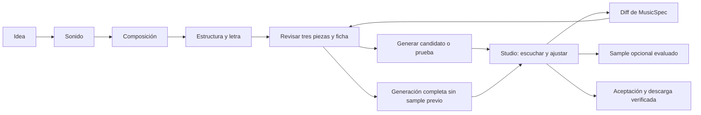

# Song Builder: arquitectura UX/UI para revisión

## Implementación incremental autorizada — 2026-10-08

Primer shell de siete pasos implementado sobre los editores actuales y MusicSpec. Incluye guía y navegación protegida, sin aplicar valores ni aprobar decisiones al avanzar. El usuario autorizó este bloque; la etiqueta histórica de autorización pendiente no bloquea la continuación. Nuevas pantallas, timeline/letra, Studio y aceptación integral siguen pendientes. Verificación agrupada: build/28 pruebas frontend; Playwright del shell pendiente.

## Decisiones vigentes del usuario — 2026-10-07

[Contrato de decisiones](SONG_BUILDER_APPROVED_DECISIONS_20261007.md): **sample previo opcional, sin bloqueo de generación completa**; instrumental como intención soportada con ejecución condicionada a validación; dirección por sección en MusicSpec aunque su traducción tenga límites; referencia audio opcional/avanzada, sin clonación; perfil ACE-Step automático por defecto y manual disponible para cualquiera. Esta decisión sustituye requisitos anteriores incompatibles en este documento. Las descripciones de pruebas/gates del árbol anterior son históricas; retirar el bloqueo de sample sigue pendiente de implementación y regresión. Mantener set válido, request confirmado y evaluación/aceptación de audio separadas.

Fecha: 2026-10-07. **Diseño propuesto; implementación pendiente de autorización del usuario.** No modifica componentes ni introduce React. El frontend actual es Vue 3/Vite; esta propuesta no requiere migrar de framework.

Este documento desarrolla la arquitectura de interacción solicitada después del [análisis técnico A–H](SONG_BUILDER_ACE_STEP_ANALYSIS_20261007.md), que conserva inventarios y evidencia de Playwright. Este documento dirige pantallas, preguntas y autoridad; el análisis anterior dirige inventario/migración técnica; `ACE_STEP_CAPABILITIES.md` dirige capacidades. Ninguno constituye otra fuente activa de datos: MusicSpec evoluciona las revisiones SQLite de `song_specs`.

Decisión de alcance: creación inicial mediante **ACE-Step 1.5 Custom / `text2music`**, sin MIDI ni audio guía obligatorio. «Custom» describe configuración explícita de caption, letra y metadatos; no es un séptimo `task_type` ni obliga a usar la UI Gradio o API de alto nivel. La ruta directa vigente puede recibir esa configuración. Cover, Repaint, Lego, Complete y Extract quedan en Studio, condicionados por disponibilidad real.

## A. Current State

### Flujo y piezas localizadas

| Área | Código/contrato actual | Lectura para el diseño |
| --- | --- | --- |
| Frontend | `frontend/index.html`, `frontend/src/app.js`, `api_client.js`, `production_actions.js`, `candidate_comparison.js`, `styles.css` | Biblioteca, Intent, Lyrics, Music Plan, MIDI, Instrumental, Voice y Production. Formularios de fase separados de ficha. Reutilizar drafts, protección de navegación, selección, propuestas y comparación. |
| MusicSpec equivalente | `backend/application/song_specification_service.py`, `song_spec_proposal.py`, repositorio SQLite `song_specs` | Catálogo 49 campos/esquema 1.1 y revisiones. MusicSpec es evolución del modelo existente. |
| Gemma | `/api/assistant/gemma`, registry y steering | Conversación, contexto activo, explicación y propuestas revisables. No aprobación automática. |
| Qwen | `/api/assistant/qwen`, `/spec/proposal`, `backend/providers/song_spec_schema.py` | Propuesta técnica estructurada y revisión; distinguir ejecución real, mock y fallback. |
| Texto y metadata | `ace_step_plan_compiler.py`, assets de letra, `productionSpecMessage` en frontend | Compilador arma caption y metadata; resumen frontend parcial no transmite todas las decisiones. Letra llega como texto separado. |
| ACE-Step | `backend/adapters/ace_step_execution.py`, `tools/acestep_generate.py`, `tools/acestep_high_level.py`, perfiles y preflight | Argumentos permitidos, generación directa/alto nivel opcional; jobs y memoria coordinados. |
| MIDI/audio histórico | `professional_song_service.py`, `generate_midi`, consultas `midi_generation_service.get` en instrumental/otras fases históricas | Camino segmentado todavía depende de MIDI. No es dependencia de creación moderna ACE-Step; conservar compatibilidad fuera del recorrido principal. |
| Audio guía/referencia | Selectores de artefactos en Production, fuentes históricas de audio y resolución en compilador | Ningún WAV guía requerido por text2music moderno. Importación propia en esta superficie pendiente; referencia no es clonación. |
| Audio/revisión | Candidates, listening review, correcciones, sample gate, final y exportación | Reutilizar reproductores/evidencia; no presentar barras decorativas como preview real. |

### Contratos HTTP existentes que se conservan

Prefijo de proyecto `/api/pro/projects/{song_id}`: GET `/spec`, POST `/spec/messages`, POST `/spec/proposal`, POST `/spec/confirm`; PUT `/ace-configuration`; POST `/ace-plan/preview`, POST/GET `/ace-plan`, POST `/ace-plan/{plan_id}/approve`; POST/GET `/ace-candidates`, GET/cancel/review/sample/correction por task; GET audio/artifacts. Fases usan PUT `/api/projects/{set_id}/phases/{phase}`. `song_id` y `set_id` son identidades distintas: resolver vínculo en backend, no intercambiarlas por semejanza de nombres. `/api/pro` no implica servicio pago.

Hace falta extender un caso de uso de patch de MusicSpec y su contrato HTTP para decisiones creativas compartidas; no afirmar que PUT `/ace-configuration` ya edita toda la ficha. Mantener compatibilidad y control optimista `revision_id`.

La auditoría del análisis anterior comprobó 49 campos visibles sin editores dentro del catálogo y el caso BPM 97 guardado en Music Plan frente a BPM 72 en la ficha. **No se repitió la sesión de navegador en esta tarea documental.** Se releyeron compilador, opciones, adaptador de alto nivel y rutas actuales. No se probaron inferencias ni audio aquí.

## B. ACE-Step Input Inventory

Base observada: instalación 1.5.0, commit `dce621408bee8c31b4fcf4811682eb9359e1bc94`, fuente instalada y wrappers locales; referencia externa: [repositorio oficial ACE-Step 1.5](https://github.com/ace-step/ACE-Step-1.5). La instalación y los adaptadores locales delimitan esta propuesta, no las novedades de la rama remota.

Estados utilizados:

- **C — conectado confirmado por código:** compilador/argumento del wrapper observado. No significa fidelidad acústica ni ejecución real probada.
- **E — existente, no integrado:** campo encontrado en fuente instalada sin traducción/control local comprobado.
- **I — interpretación inferida:** deseo que puede proponerse como texto musical; eficacia específica pendiente de escucha.
- **N — no soportado por la integración:** no se ofrece como operación ejecutable; conservar requisito y explicar límite.

Para text2music están conectados caption/lyrics, BPM, tonalidad, compás, idioma vocal, duración, perfil Base/Turbo, seed, pasos, guidance, shift, ruta de API y LM opcional. Referencia musical está traducida y requiere artefacto registrado, pero su utilidad en la combinación específica task/model/API necesita prueba real: **no requisito ni promesa de identidad vocal**.

No llevar al Builder de creación: `src_audio`, intervalo repaint, pistas Lego/Extract/Complete ni fuerza cover. Aunque el wrapper posee algunos argumentos, solo tienen utilidad verificada cuando aplica su acción. Instruction libre no es un prompt general adicional: el objetivo humano se conserva en intención y se compila a caption/lyrics compatibles.

La API instalada tiene 72 campos GenerationParams y 9 GenerationConfig, enumerados en el análisis técnico. Global caption, instrumental, sampler, schedules, ADG, CFG interval, retake, flow-edit, DCW, normalización y fades no tienen controles explícitos locales comprobados. Algunos defaults pueden influir en la ruta de alto nivel: registrar valores efectivos antes de compararla con handler. `audio_codes` es salida/condicionamiento del LM opcional, no un campo para introducir notas MIDI. Batch/formato/políticas CoT están fijados por wrapper; no crear sliders para ellos.

## C. Input Mapping Matrix

La matriz precede al diseño. Columna MusicSpec: nombres planos existentes cuando existen; `*` indica extensión conceptual pendiente, no campo ya persistido. Required: **G** requisito actual de compilación/configuración, **H** necesario si el deseo lo exige, **O** opcional, **S** valor del sistema. C/I distingue traducción existente de interpretación pendiente. Todos los deseos quedan trazados incluso si no caben en caption; no truncarlos silenciosamente.

| ACE-Step input/capability | MusicSpec | Intención humana | UI | Responsable | Required | AI puede sugerir | Dependencias |
| --- | --- | --- | --- | --- | --- | --- | --- |
| `caption` / `captions` (C) | Proyección de campos musicales | «Así quiero que suene» | Resumen humano; texto compilado en detalles | SYSTEM compila; USER confirma | G | Sí, cambios propuestos | Revisión aprobada; 1–512 caracteres actuales |
| Estilo en caption (C) | `song_type`; `genre*`, `subgenre*`, `style*` | Balada, pop, estilo propio | Chips + Otro/texto libre | USER / AI_SUGGESTED | H | Sí | Extensiones deben entrar al mapper; no existen aún como argumentos nativos |
| Mood en caption (C) | `emotion` | Romántica pero triste | Cards multiselección + texto | USER / AI_INFERRED | H | Sí | No tratar emociones combinadas como conflicto automático |
| Instrumentos en caption (C) | `instruments` | Piano protagonista, poca guitarra | Chips incluir/evitar + prioridad | USER / AI_SUGGESTED | H | Sí | Requisitos negativos requieren adaptación de texto/evaluación |
| Groove en caption (C) | `groove` | Balanceo suave, pulso marcado | Descriptores humanos | USER / AI_SUGGESTED | O | Sí | Estilo y BPM; no algoritmo rítmico determinista |
| Dinámica en caption (C) | `dynamic_arc` | Crece hasta el último coro | Presets de evolución + texto | USER / AI_SUGGESTED | H | Sí | Estructura; no curva DSP exacta |
| Carácter sonoro (I) | `sonic_character*` | Cálida, cruda, íntima | Chips y explicación | USER / AI_SUGGESTED | O | Sí | Pendiente incluir en caption sin exceder presupuesto |
| Voz en caption (C) | `voice_style` | Femenina, masculina, dúo, voz suave | Cards + Otra descripción | USER | H | Sí | Dúo es intención aproximada; no asignación garantizada de cantantes |
| Expresión/rango en caption (C) | `vocal_expression`, `vocal_range` | Al oído; canto amplio | Descriptores; rango con ayuda contextual | USER / AI_SUGGESTED | O | Sí | No prometer alturas/notas exactas |
| Mezcla deseada en caption (C) | `mix_balance` | Voz clara al frente | Cards/descripción; explicación | USER / AI_SUGGESTED | O | Sí | Condicionamiento, no fader de mezcla |
| `lyrics` (C) | Asset/version de letra y `structure` | Texto completo o parcialmente propio | Editor por sección; importar/pegar texto | USER; IA propone | G actual | Sí, en alcance elegido | 1–4096 caracteres; usuario confirma texto exacto |
| Tags de sección en lyrics (C como texto) | `structure`, `sections*` | Verso, coro, puente, intro | Timeline por bloques + editor | USER / AI_SUGGESTED | H | Sí | Tags permitidos por serializador; estructura exacta no garantizada |
| Dirección de sección (I) | `sections*.direction`, energía/voz/instrumentos | «El último coro debe explotar» | Seleccionar bloque + dirección libre | USER / AI_SUGGESTED | H | Sí | Compilar solo instrucciones compatibles; no mezclar con palabras a cantar |
| Frases/exclusiones en letra | `required_phrases`, `excluded_content`, `locked_spans*` | «Esta línea no cambia» | Bloquear línea; requisitos visibles | USER | H | Sí, sin alterar bloqueado | Validador de letra antes de compilación y escucha posterior |
| Narrador/tono/rima | `narrator`, `lyrical_tone`, `rhyme_preference` | Primera persona, sin rima forzada | Opciones + texto libre | USER / AI_SUGGESTED | O | Sí | Preparación de letra; no parámetros nativos |
| Pronunciación deseada (I) | `pronunciation` | Nombre/acento correctos | Nombre/frase + nota | USER | H | Sí | Actualmente conservada; adaptación/evaluación pendiente, sin garantía fonética |
| `bpm` (C) | `bpm` | Lenta, media, rápida | Sensación + recomendado; número con ayuda | USER / AI_SUGGESTED | G | Sí | Entero 30–300; rango humano recomendado no cambia rango válido |
| `keyscale` / `key_scale` (C) | `key` | Tonalidad propia o delegada | Recomendación explicada; selector con ayuda | USER / AI_SUGGESTED | G actual | Sí | Compilador exige tonalidad válida; vacío auto nativo no conectado |
| `timesignature` / `time_signature` (C) | `time_signature` | Pulso habitual o balanceo ternario | Recomendación; 2/4,3/4,4/4,6/8 con ayuda contextual | USER / AI_SUGGESTED / DEFAULT | G efectivo | Sí | Traducción 2,3,4,6; default explícito 4/4 |
| `duration` / `audio_duration` (C) | `duration_seconds` | «Unos tres minutos» | Minutos/segundos; objetivo con ayuda | USER / AI_SUGGESTED | G | Sí | 10–600 s; objetivo, no duración exacta garantizada |
| `vocal_language` (C) | `language` | Letra en español | Idioma, detectado con revisión | USER / AI_INFERRED | G | Sí | Código de dos letras válido; mixtos requieren limitación explícita |
| `task_type=text2music` (C) | `task_type` | Crear primera versión | Informativo; no menú de seis modos inicial | SYSTEM | S | No | Studio propone otras operaciones después |
| Modelo/config (C) | `ace_step_config` | Perfil automático o elección experta | Automático por defecto; editor manual con ayuda contextual | SYSTEM / USER | G | Sí | Preflight real; perfiles locales, no autoafirmar calidad superior |
| `seed` (C) | `seed` | Repetir configuración o explorar variante | Avanzados, «Variación» + número | USER / DEFAULT | O | Sí | 0–4294967295; misma seed no garantiza identidad entre perfiles/hardware |
| `inference_steps` (C) | `inference_steps` | Ajuste de ejecución | Control técnico con ayuda, recomendado por perfil | USER / DEFAULT | O | Sí | Turbo 1–20, Base 1–200; no prometer más calidad por más pasos |
| `guidance_scale` (C) | `guidance_scale` | Ajuste técnico de condicionamiento | Control técnico con ayuda; bloqueado a 1 en Turbo | USER / DEFAULT | O | Sí | 1–15; Turbo exige 1 |
| `shift` (C) | `shift` | Ajuste técnico de generación | Control técnico con ayuda, delegable | USER / DEFAULT | O | Sí | 0.1–10; valor efectivo del perfil registrado |
| Ruta directa/alto nivel (C) | `generation_api` | Perfil de ejecución | Avanzados; directa por defecto | USER / DEFAULT | O | Sí | No cambia autoridad ni exige nueva API para Custom |
| LM interno opcional (C en ruta) | `lm_model_path` | Experimentar condicionamiento musical | Ajuste experimental accesible | USER / DEFAULT | O | Sí | Solo high_level_lm/text2music; pesos/memoria; CoT rewrite desactivado |
| `reference_audio` (C traducción) | `reference_artifact_id` → ruta derivada | Referencia musical opcional | Avanzados «Añadir referencia» cuando validado | USER; SYSTEM verifica | O | Puede sugerir uso | Importación pendiente; artefacto propio/checksum; eficacia real por ruta pendiente |
| `instrumental` (E) | `vocals*.enabled` / intención vocal actual | Sin canto | Opción con estado pendiente de integración | USER | H | Sí | Booleano no enviado ni consumo demostrado; `[Instrumental]` no acredita ausencia de voz |
| `audio_codes` (salida LM) | Evidencia de run, no configuración manual | Sin decisión adicional | Detalles de ejecución | SYSTEM | S si LM | No | No introducir MIDI/WAV como cadena arbitraria |
| WAV/lote/políticas de wrapper | Run/config efectiva; `output_format` para derivados | Descargar audio | Formatos verificados, no slider de lote | SYSTEM / USER formatos | S/O | Sí | Alto nivel fija WAV y lote 1; MP3/FLAC son pasos de exportación |

Los otros campos del catálogo —título, destinatario, tema, brief, quality_profile, sample_duration_seconds, production_route y tolerancia— organizan contexto, aceptación y entrega. No son nuevos parámetros ACE. La matriz, el catálogo completo del análisis anterior y la lista de campos nativos excluidos cubren también lo delegado/informativo, sin un formulario de 81 controles.

## D. MusicSpec Proposal

Mantener SQLite como verdad activa, con MusicSpec en una revisión de `song_specs`; assets y su contenido siguen separados y vinculados por versión. UserIntent registra declaraciones y origen mediante eventos/tasks, no un segundo estado creativo editable. AceStepRequest es exportación compilada congelada. JSON/Markdown se regeneran desde esa revisión.

Esquema conceptual: `concept`, `sound`, `composition`, `vocals`, `lyrics_asset`, `sections`, `requirements`, `decision_metadata`, `generation`, `acceptance`. Inicialmente usar proyección del esquema plano actual; nuevos campos solo tras migración explícita. No almacenar valores duplicados en plano y anidado como dos fuentes activas.

| Propiedad de sección | Utilidad | Traducción y límite |
| --- | --- | --- |
| ID estable, tipo, orden, título | Edición, referencia y feedback | Tags de estructura; IDs nunca van al caption como instrucciones. |
| Texto/contenido por referencia al asset | Letra propia/parcial, revisión y edición | Serializar palabras cantadas; contenido canónico una vez. |
| Energía/intención emocional | Planear contraste y clímax | Caption/dirección aproximados; no `desperation=0.9`. |
| Dirección de voz e instrumentos | Sugerencia de arreglo por sección | Conservar deseo y mapear solo sintaxis validada; no prometer cambios exactos. |
| Duración objetivo aproximada | Revisar coherencia del plan | Sin control exacto por sección. Separada de tiempos observados del audio. |
| Locks de estructura/texto/dirección | Proteger decisiones al regenerar letra o proponer cambios | Política de edición, no garantía acústica. |
| Intervalo observado y procedencia | Selección futura en Studio | Derivado/manual sobre audio concreto; no usar duración planeada como alineación real. |

No añadir automatización de plugins, notas MIDI ni stems obligatorios. Una versión instrumental conserva las tres piezas del contrato: instrumental, intención de melodía vocal/sin canto y asset de letra marcado instrumental; su comportamiento de generación requiere integración y aceptación antes de ofrecerlo como operativo.

### Modelo de letra y regeneración parcial

CONTENT conserva palabras destinadas a cantarse; STRUCTURAL INSTRUCTION identifica tipo/orden de sección y etiquetas serializables; PERFORMANCE/DIRECTION conserva interpretación deseada. La separación es interna al documento y al editor: no crear tres letras distintas. El serializador incluye solo tags/instrucciones admitidos, muestra su preview antes de aprobar y comprueba que una nota de dirección no termine como verso accidental.

- Letra propia: pegar/importar texto, proponer división en secciones como diff y conservar texto original. No reescribir ni corregir nombres sin permiso.
- Letra IA: proponer secciones/texto desde requisitos persistidos, con procedencia y revisión visible; aprobar explícitamente.
- Letra parcial: el usuario marca secciones vacías o líneas para completar; la IA recibe contexto y alcance, no permiso para reemplazar toda la letra.
- Regeneración parcial: elegir sección/líneas y motivo, conservar locks y requisitos globales, comparar antes/después, aplicar al borrador y guardar revisión. Si el patch afecta otro alcance o frase protegida, rechazarlo.
- Sección instrumental: sin palabras cantadas; marcador estructural cuando el serializador lo soporte. No garantiza silencio vocal ni sustituye integración de canción enteramente instrumental.

Ejemplo de decisión conceptual: `/sections/sec_final/direction` = «El mayor clímax emocional». Metadata: `origin=USER`, `confirmed=true`, `locked=true`, `source_event_id=…`. El mapper registra caption/tag compatible o limitación; nunca inventa un parámetro numérico del motor. Los timestamps observados pertenecen a la versión de audio, no a esta dirección creativa.

## E. Authority Model

Cada campo/requisito tiene valor único, origen USER/AI_SUGGESTED/AI_INFERRED/DEFAULT/SYSTEM, evento fuente, revisión, confirmación y locks cuando corresponda. Confianza estimada opcional y etiquetada; nunca acredita inferencia correcta por sí misma.

Orden: decisión explícita USER > sugerencia AI confirmada > inferencia AI > default. SYSTEM aplica formato/validación/capacidades, **no sobrescribe creatividad**: incompatibilidad produce bloqueo y alternativas. Una propuesta aceptada mantiene su origen AI_SUGGESTED y registra quién la confirmó; no falsificar su procedencia como texto original del usuario.

Acciones de sugerencia: **Aplicar a borrador / Modificar / Ignorar**. «Aplicar» deja un cambio visible pendiente de **Guardar revisión**; no autopersistencia. Una aplicación por lote muestra todos los cambios y excluye locks. El usuario puede desbloquear explícitamente; la IA no puede hacerlo.

Locks tienen alcance: línea, sección, decisión o requisito; no congelan toda la canción por accidente. Regenerar una sección de letra debe conservar bytes/texto bloqueado según política explícita y rechazar un patch que lo altera. «Conserva la voz» protege intención/perfil de referencia; identidad exacta del audio no queda garantizada.

Guardar un cambio creativo crea revisión y recalcula vigencia de plan/sample. Abrir/cerrar ayuda o detalles no crea revisión musical. Resolver edición concurrente por `revision_id`; mostrar diff de cambios, no última escritura silenciosa.

## F. UX Flow

Recorrido principal propuesto: **Idea → Sonido → Composición → Estructura y letra → Revisar → Generar prueba → Studio**. Las tres piezas se preparan dentro de esos pasos; no tres herramientas que el amateur deba componer manualmente. Antes de generar hay selección de tres drafts y set válido; preparación inicial no crea un set incompleto.



| Interfaz común | Presentación | Control que conserva |
| --- | --- | --- |
| Song Builder asistido | Texto libre, cards/chips, controles musicales visibles, recomendaciones y ayuda contextual | Mismos controles y revisión para todos; ajustes adicionales accesibles por tarea, sin perfiles de experiencia. |

**Ejemplo:** «Romántica pero triste, dos personas que se aman y deben separarse» establece tema/emoción en borrador. No preguntar otra vez tema o emoción. Si estilo/voz no se conocen, pedir una decisión a la vez con propuestas o delegación. BPM 74, Am, 4/4, 3:30 pueden aparecer como recomendación contextual, no hechos deducidos ni valores universales. Aceptar una recomendación exige acción visible; guardarla exige confirmación.

En Sonido: estilo, instrumentos, voz y evolución; no mostrar caption bruto como campo principal. En Composición: sensación de velocidad, duración y recomendaciones; BPM/tonalidad/compás en «Personalizar». En Estructura y letra: elegir plan propuesto, reordenar bloques, editar y proteger texto. Se puede volver a pasos anteriores sin perder borrador; salir con cambios ofrece guardar o descartar.

## G. Screen Architecture

Componentes conceptuales, no implementados ni ligados a React. Separar vista, estado de borrador y llamadas a casos de uso; adaptar incrementalmente Vue actual.

| Pantalla/componente | Responsabilidad | Acción principal |
| --- | --- | --- |
| BuilderShell | Proyecto activo, paso, progreso y borrador | Continuar al pendiente relevante. |
| IdeaStep | Texto original, deseos extraídos y aclaraciones | Revisar interpretación. |
| SoundStep | Género/estilo, mood, instrumentos, voz, evolución | Confirmar decisiones de sonido. |
| CompositionStep | Recomendaciones y metadata editable | Aceptar propuesta o personalizar. |
| StructureLyricsStep | Bloques, contenido por sección, locks y generación parcial | Revisar letra y estructura. |
| DecisionCard / SuggestionDiff | Valor, origen, explicación, delegación y conflictos | Aplicar al borrador/modificar/ignorar. |
| CopilotPanel | Gemma explica el contexto y Qwen aporta revisión; respuesta ligada a revisión | Pedir ayuda sin reemplazar controles. |
| SpecReview | Ficha en lenguaje humano y tres piezas seleccionadas | Guardar y confirmar revisión. |
| GenerationPreflight | Bloqueos, advertencias y solicitud compilada accesible en detalles | Confirmar plan y generar prueba. |
| GenerationStatus | Estado real de task, memoria, cancelación y recuperación | Esperar/cancelar según estado. |
| StudioShell | Versión escuchada, waveform real, selección, versiones y feedback | Escuchar o proponer ajuste. |
| SampleApproval / FinalExport | Evidencia vigente, aceptación y archivos comprobados | Aprobar sample; generar final; descargar. |

Wireframe de la interfaz común, escritorio:

```text
Proyecto: Separarnos             Ayuda contextual | Ficha de la canción
Idea ✓   Sonido ●   Composición   Letra   Revisar

¿Cómo quieres que suene?          Tu intención
[Balada] [Pop] [Indie] [Otro…]    Romántica y triste
[Piano] [Guitarra] [Otro…]       IA propone: piano suave
Voz: [Femenina] [Masculina]       [Aplicar] [Modificar] [Ignorar]
     [Dúo: resultado aproximado]  ¿Por qué lo recomienda?
     [Instrumental: pendiente]
Evolución: [Íntima] [Crece] [Otra descripción…]

[Ajustes avanzados]     Cambios sin guardar
[Atrás]                          [Continuar]
```

Wireframe Studio:

```text
Versión 1 · candidato · pendiente de escucha
[Reproducir] waveform real [tiempo actual]
Estructura prevista: Intro | Verso | Coro | Puente | Coro final
Intervalo seleccionado: 02:10–02:35 [Ajustar selección]
¿Qué quieres cambiar aquí? [Más intensidad, menos guitarra…]
[Proponer ajuste] → Diff y límites → [Guardar revisión]
Operación propuesta: Repaint · requiere revisar intervalo
[Comparar V1/V2] [Revisar sample] [Final disponible según set y request]
```

Timeline inicial representa composición prevista, no audio alineado. Studio muestra esa distinción; si no hay alineación comprobada, selección manual sobre waveform. No dibujar un corte exacto de coro a partir de tiempos aproximados.

Accesibilidad: navegación por teclado, foco en pregunta/error, labels asociados, estados legibles sin color, chips con estado seleccionado y opción de texto, controles de timeline con alternativa lista/reordenar por botones, sliders con campo numérico y unidades. En móvil: una columna, copiloto plegable y una acción principal; ninguna decisión depende de hover.

Persistencia de interacción: recuperar proyecto/revisión guardados desde SQLite, restaurar paso y paneles abiertos como preferencias de UI y advertir sobre borrador no guardado. Navegar entre pasos conserva ese borrador; cambiar proyecto exige guardar/descartar. Propuestas tardías de otro proyecto o revisión nunca lo rellenan. Error de modelo permite reintentar o editar manualmente; no presentar fallback como recomendación real. Una cancelación de generación muestra task cancelada y conserva inputs para reintentar.

## H. Dynamic Questioning

Orden determinista: conflicto bloqueante → obligación creativa no resuelta → dato requerido por compilador → preferencia de alto impacto → opcionales delegables. El planner usa revisión, origen, locks, capacidades y preguntas anteriores; los modelos explican/proponen, no inventan requisitos del motor.

| Condición | Comportamiento |
| --- | --- |
| Valor explícito o sugerencia confirmada | Mostrar resumen editable; no volver a preguntarlo. |
| Inferencia suficientemente clara y reversible | Mostrar «Interpretamos…»; agrupar en revisión, no interrumpir por cada campo. |
| Duda cambia resultado materialmente | Una pregunta con alternativas y texto libre/delegación. Confianza baja sola no basta: considerar impacto. |
| «Romántica y triste» | Preservar ambos; no forzar una emoción única. |
| «Sin canto» y letra cantada obligatoria | Explicar contradicción y pedir cuál intención conservar; no borrar letra. |
| Duración/estructura incoherentes | Mostrar total aproximado y proponer redistribución; no exigir teoría musical. |
| text2music inicial | No pedir fuente, MIDI, pistas ni intervalo; referencia musical opcional solo con soporte observado. |
| Campo no conectado | Mostrar limitación si relevante al deseo, no un control operativo ficticio. |
| Lock frente a propuesta | Excluir del patch y explicar; pedir desbloqueo explícito solo si indispensable. |
| Abrir ayuda o detalles | Conservar datos/preguntas ya respondidas; cambia presentación. |

La completitud no exige que el usuario conozca todos los parámetros. Puede delegar tempo/tonalidad/ajustes y revisar propuestas agrupadas, viendo ficha completa y valores efectivos. El botón Continuar no equivale a aceptar una sugerencia invisible.

## I. Preflight

Gate añadido por el usuario: [AC-ACE-USER-01](ACE_STEP_USER_INPUT_ACCEPTANCE.md). Cada input conectado debe probar conservación de decisiones USER hasta request y transformaciones trazables, con autorización cuando cambien contenido/significado. Pruebas pendientes; documentación no equivale a aceptación.

Dos capas visibles: **«Tu canción está definida»** y **«El motor puede ejecutarla»**. Estados por familia: confirmado, propuesto, delegado resuelto, pendiente, no aplicable, conflicto; un check no equivale a audio aceptado ni a inferencia Qwen real.

1. Intención: tema/estilo, voz, instrumentos, estructura, letra/restricciones; distinguir obligatorio y preferido. Revisar tres assets seleccionados y set válido.
2. Determinista: revisión confirmada, BPM/rangos/key/compás/idioma/duración, tags y texto, locks, frases/exclusiones, límites caption 512 y lyrics 4096 actuales; nunca truncar. Fuente solo si operación requiere.
3. Revisión modelo: Qwen coherencia/viabilidad y Gemma explicación desde contexto persistido. Identificar run real/mock/fallback. Recomendaciones no bloquean por mera preferencia del modelo.
4. Traducción: mostrar cobertura deseo → campo → caption/lyrics/argumento o límite. Obligación no traducible bloquea hasta decisión humana; preferencia aproximada requiere explicación/aceptación.
5. Ejecución: pesos/perfil/ruta disponibles, memoria, artefactos verificados y configuración efectiva. La revisión musical no certifica hardware.
6. Confirmación: ficha humana, letra exacta y resumen de ejecución. Detalles avanzados opcionales muestran caption/request, sin JSON obligatorio para amateur.

Confirmar → validar otra vez en backend → congelar revisión/request/hashes en SQLite y task → liberar Gemma/Qwen y comprobar memoria → cargar ACE-Step → ejecutar. ACE no depende de LLM residentes. Al fallo, preservar spec y plan; reintentar con misma revisión o proponer cambios explícitos, sin fallback creativo oculto.

Para una **prueba/candidato inicial** no se exige sample previo. Para **generación completa**: set válido y revisión/request confirmados, sin exigir sample previo. Si existe sample, evaluar su vigencia solo como evidencia opcional. V1 es un candidato aunque tenga duración completa: mantener aceptación del resultado separada de generación. Calidad requiere integridad, escucha completa y aceptación registrada.

## J. Studio Transition

Al obtener audio, abrir Studio con versión, revisión/request, reproductor real, estado de evaluación y acción de escucha. No volver al inicio. Retornar al Builder para decisiones amplias sigue disponible conservando proyecto.

Feedback está ligado al artefacto escuchado y alcance (global/sección/intervalo), con requisitos a conservar. Gemma lo explica, Qwen propone diff/viabilidad; usuario revisa y guarda nueva MusicSpec. Deterministic mapper selecciona una operación compatible después de conocer cambio, fuente, intervalo y modelo, no por palabra clave aislada.

| Solicitud | Operación candidata | Guardas y límites |
| --- | --- | --- |
| Cambio global de estilo/voz/tempo | Regenerar text2music o cover | Comparar conservación deseada; cover requiere fuente y fuerza. Ninguna promete identidad exacta. |
| Cambiar una letra o intensidad en fragmento | Repaint | Fuente verificada e intervalo real manual/observado; no promete editar solo palabras sin afectar voz/arreglo. |
| Añadir parte instrumental concreta | Lego | Base disponible, fuente, una pista/instrucción e intervalo aplicable. |
| Completar pistas faltantes | Complete | Base, fuente y lista admitida; no asumir stems editables independientes. |
| Obtener una pista | Extract | Base, fuente y una pista; resultado necesita comprobar aislamiento. No es edición de letra. |
| «Conserva la voz» | Restricción sobre cualquier operación | Conservar intención/referencia cuando proceda; si exige identidad exacta y no hay soporte, informar bloqueo. |

Versiones V1/V2 conservan padre, revisión, operación, request, artefacto y feedback. Comparación A/B reutiliza componente actual; aprobación sample pertenece a artefacto/revisión vigente, no se hereda por copiar nombre. Al editar, invalidar aprobación relevante. Exportación muestra WAV/otros formatos realmente generados y verificados; no anunciar mastering profesional por terminar una task.

Studio mínimo: reproducción, waveform calculada del archivo, selección temporal, estructura prevista versus observada, feedback, diff, operación propuesta, progreso, comparación, sample y exportación. Sin mixer DAW, piano roll ni automatización profesional como requisito.

## K. Current-Code Gap Analysis

| Estado | Elementos | Tratamiento |
| --- | --- | --- |
| Existe y sirve | SQLite/revisiones, assets, sets, catálogo, schema Qwen, steering, tasks/orquestación, compilador, jobs, comparación/review/sample | Reutilizar puertos/casos de uso y guardas. |
| Falta | Patch creativo compartido, interfaz común, preguntas por relevancia, editor de ficha por familias, locks por línea/sección, importación/audio selection, timeline con estados previstos/observados | Añadir incrementalmente con contratos y pruebas. |
| Conflicto | BPM de fase distinto de ficha; resumen parcial; controles históricos sugieren procesamiento no conectado; guía MIDI obligatoria | Unificar revisión y request, actualizar recorrido sin borrar compatibilidad. |
| Fuera del alcance principal | MIDI/DAW/mezcla segmentada, servicios pagos descartados | Conservar código histórico; no ampliar ni usar como dependencia del Builder. |
| Capacidad pendiente | Instrumental boolean, voz personalizada, instrucciones finas por sección, defaults avanzados/API | Separar intención de ejecución; integrar solo con traducción y evidencia. |

Arquitectura hexagonal: componentes visuales llaman casos de uso; los providers no conocen pantallas. Perfil de capacidades no carga modelos; compilador no coordina memoria. DRY: catálogo/perfil/reglas compartidos entre UI, backend y mapper. Separar Builder y Studio por tarea, no duplicar MusicSpec.

## L. Migration Plan

| Fase / sprint | Cambio propuesto, después de autorización | Aceptación |
| --- | --- | --- |
| 0 / S00 | Revisar este diseño; perfil de inputs Custom/text2music y reglas compartidas | Matriz aprobada; campos E/I/N no anunciados como controles ejecutables. |
| 1 / S03–S05 | Patch único y procedencia; mapping desde fases; API compatible, conflictos/locks | BPM 97 guardado llega a request 97; descarte y concurrencia protegidos; no pérdida de datos históricos. |
| 2 / S06A | BuilderShell, Idea/Sonido/Composición, interfaz común asistida en Vue actual | Misma revisión en controles y conversación; lenguaje libre; no reask de información conocida ni MIDI/fuente obligatorios. |
| 3 / S06B | Estructura/letra por sección y propuestas/diffs | Letra propia, parcial, IA; locks conservados; instrucciones separadas del contenido; límites y restricciones comprobados. |
| 4 / S06C | Preflight/request congelado y ejecución exclusiva | Mock captura argumentos exactos, defaults efectivos y hashes; plan persiste antes de liberar LLM; pruebas reales separadas. Instrumental operativo solo tras aceptación específica. |
| 5 / S06D | Studio mínimo, waveform real, selección y feedback | No vuelve al formulario inicial; diff explícito, versiones A/B y sample actualizado. |
| 6 / S06C–S06D | Importación y acciones Studio según disponibilidad | Validar fuente/pistas/intervalos/modelo; contrato por seis modos y evidencia real por modo disponible. |
| 7 / S06E–S10 | Final/export y piloto amateur | Backend permite generar completo sin sample previo y conserva validación de set/request; archivos verificados; pruebas de tareas con personas sin teoría musical. |

Archivos a evolucionar: `frontend/index.html`, `frontend/src/app.js`, `styles.css` y módulos de acciones/API; `song_specification_service.py`, `song_spec_proposal.py`, `ace_step_configuration.py`, `song_spec_schema.py`, `ace_step_plan_compiler.py`, `ace_step_execution.py`; validadores/perfiles ACE; endpoints y repositorios actuales. Extraer vistas/estado en módulos pequeños al implementar, sin trasladar todo a otro monolito. Paid ProfessionalSongService permanece conservado; sus consumidores locales se migran por casos de uso sin romper rutas.

No se cierra ningún sprint por aprobar el diseño. Gates: integración del valor hasta request, build/regresión, evidencia real de audio cuando corresponda, escucha y piloto amateur. En esta tarea solo hay revisión documental/código; no nuevas pruebas de UI ni ejecución de modelos.

## M. Open Decisions

No bloquean este documento; requieren revisión antes de implementar o habilitar la capacidad correspondiente:

| Decisión | Recomendación y responsable |
| --- | --- |
| Aprobar interacción y vocabulario | Usuario revisa este diseño; validar «Guiado», «Sonido», «Composición», «Prueba», «Sample» con amateurs. |
| V1 de prueba: fragmento o candidato completo | Mantener etiqueta candidato; definir coste/representatividad con capacidad real. Un fragmento sin voz/configuración representativa no aprueba final. |
| Instrumental sin canto | No habilitar promesa hasta conectar/observar ruta y audio; definir adaptación de tres assets sin excepción silenciosa. |
| Granularidad de locks y políticas de texto | Proponer línea/sección/campo; acordar si exactitud protege puntuación/espacios además de contenido. |
| Direcciones por sección | Probar sintaxis serializada para evitar que instrucciones se canten; sin evidencia, conservar como intención y explicar límite. |
| Alineación estructura/audio | Primera entrega manual con tiempos reales; automatización posterior solo si aporta y se valida. |
| Referencia musical opcional en creación | Mostrar solo tras importación y prueba de utilidad por task/model/API; no prometer identidad vocal. |
| Perfil por defecto y controles avanzados | Mantener ruta directa/perfil vigente; comparar audio/coste antes de recomendar otro. Vulkan Gemma/Qwen se conserva. |
| Piloto amateur | Definir participantes/tareas y criterio de éxito antes de declarar UX validada. |

**Criterio central:** el amateur debe expresar toda intención transmisible mediante lenguaje libre, decisiones humanas, letra y dirección por sección; el avanzado debe controlar parámetros reales con ayuda contextual. Esa cobertura está diseñada, pero su comprensión y eficacia requieren implementación y prueba con personas, no se dan por aprobadas por este documento.
